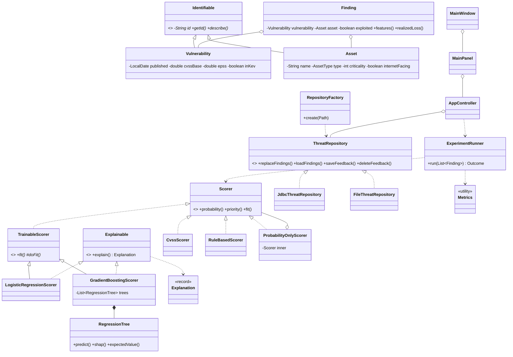

# System design

## Architecture (layers)
```
 GUI (Swing: MainWindow/MainPanel/charts)  <->  AppController  <->  ThreatRepository (JDBC | CSV)
                                                   |
                       ExperimentRunner (thread pool) --- Metrics / StabilityEvaluator
                                                   |
                         Scorer implementations (CVSS, Rule, LR, GBDT+TreeSHAP)
                                                   |
                            Finding = Vulnerability + Asset (+ label)
```
Data flow: generate/import -> persist -> deduplicate by CVE -> temporal split (train <2023, validation 2023, test >=2024)
-> train (parallel) -> evaluate -> rank by risk -> explain -> analyst rating stored in DB.

## UML class diagram (Mermaid - renders on GitHub; paste into https://mermaid.live to export PNG/SVG for the report)


## Design patterns used
| Pattern | Where |
|---|---|
| Strategy / polymorphism | `Scorer` with 4 interchangeable methods |
| Template method | `TrainableScorer.fit()` -> `doFit()` |
| Decorator | `ProbabilityOnlyScorer` wraps any `Scorer` |
| DAO + Factory | `ThreatRepository`, `RepositoryFactory` (JDBC if driver present, else files) |
| MVC-style | `MainPanel` (view) / `AppController` (controller) / model + eval packages |

## Key design decision: probability vs impact
Probability models see only threat evidence + exposure (`Finding.features()`); asset criticality is excluded. Impact = criticality/5 (`ImpactModel`).
Priority = probability x impact. The `ProbabilityOnlyScorer` ablation shows the separation matters (NDCG@50 +0.079, 95% CI [+0.006, +0.164]).
